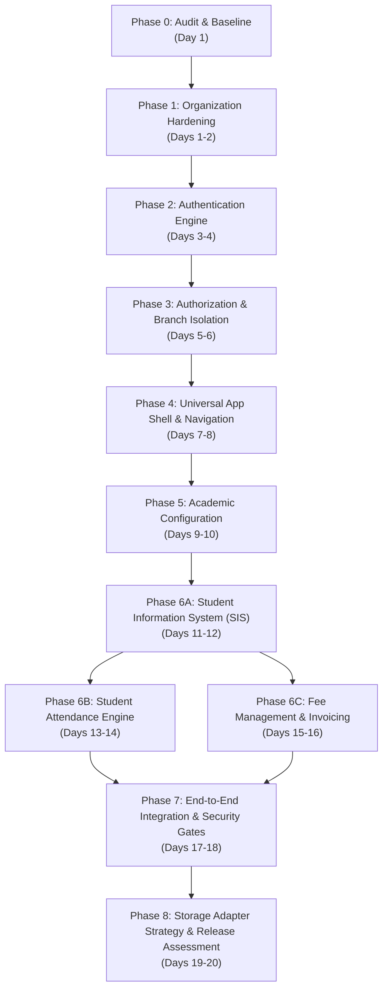

# School Universel — 20-Day Master Development Roadmap

**Target Timeline:** 20 Working Days  
**Scope Strategy:** Core Foundation + Usable Minimum School Release (SIS, Academics, Attendance, Fees)  
**Architecture Policy:** Database-Independent Domain Engine (In-Memory baseline with SQLite & PostgreSQL adapter strategy)  
**Governance:** Mandatory Phase-Gate Protocol (One module verified & locked at a time)

---

## 1. Executive Strategy & Scope Boundaries

Building all 22 planned modules in 20 days is architecturally irresponsible and guarantees poor software quality. This roadmap deliberately stratifies the project into:

1. **The 20-Day Target Scope (Phases 0–8):**
   - Engineering Foundation & Audit Baseline
   - Organization & Multi-Campus Hardening
   - Authentication & Identity Engine
   - Role-Based Authorization & Strict Branch Isolation
   - Universal Dashboard Application Shell & Design System v1.0
   - Core Academic Curriculum & Class Hierarchy
   - Student Information System (SIS) & Guardian Profiles
   - Student Attendance Tracking Engine
   - Fee Management & Invoicing Foundation
   - Storage-Adapter Architecture & Integration Verification
2. **Deferred Scope (Post-20-Day Roadmap):**
   - Phase 03: Full Public Admissions Assessment Pipeline
   - Phase 07: Automated Timetable Generation
   - Phase 09: Advanced Examinations Moderation & Report Card Generator
   - Phase 10: Homework & Learning Management System
   - Phase 12: Multi-Account Double-Entry Financial Accounting
   - Phase 13: Staff Payroll & HR Workflows
   - Phase 14: Inventory & Purchasing
   - Phase 15: Library Management
   - Phase 16: Transport & Vehicle GPS Tracking
   - Phase 17: Health, Safeguarding & Medical Incidents
   - Phase 18: Activities & Discipline Records
   - Phase 19: Multichannel SMS/Email Delivery Service
   - Phase 20: Certificate Generator
   - Phase 21: High-level Multi-Campus Analytics
   - Phase 22: Automated Backup, Point-in-time Recovery & GDPR Tools

---

## 2. High-Level Dependency Graph

---

## 3. Detailed Day-by-Day Implementation Plan

### Phase 0 & Phase 1: Baseline Hardening & Organization Verification (Days 1–2)

#### Day 1: Audit Baseline, Workspace Tooling & Validation Fixes
- **Goal:** Resolve audit findings F-03 and F-06; establish cross-workspace typechecking.
- **Dependencies:** Master Audit Report.
- **Affected Areas:**
  - `package.json`
  - `packages/validation/src/index.ts`
  - `backend/src/modules/organization/tests/organization.test.ts`
- **Work Items:**
  1. Add workspace aggregation scripts in root `package.json` (`typecheck:all`, `build:all`, `test:all`).
  2. Implement chronological parent-child date constraint validation in `validateAcademicYear()`:
     - Verify `term.startDate >= academicYear.startDate`.
     - Verify `term.endDate <= academicYear.endDate`.
  3. Expand `organization.test.ts` with assertions verifying that out-of-range term dates are rejected with `VALIDATION_FAILED`.
- **Required Tests:** Unit tests verifying term date bounding; workspace typecheck across root, web, and backend.
- **Acceptance Criteria:** `npm run typecheck` passes across all packages; term dates outside academic year bounds fail validation deterministically.

#### Day 2: Organization Domain Edge Cases & UI Polish
- **Goal:** Complete and lock the Organization domain for multi-branch readiness.
- **Dependencies:** Day 1 validation fixes.
- **Affected Areas:**
  - `backend/src/modules/organization/`
  - `apps/web/src/app/organization/page.tsx`
  - `apps/web/src/features/organization/`
- **Work Items:**
  1. Add branch deactivation safeguards (ensure deactivating a branch requires moving active classes/students).
  2. Implement shift overlap validation in branch configuration.
  3. Wire frontend toast/notification feedback using Design System status tokens for create/update events.
  4. Ensure empty states and error recovery are accessible and responsive.
- **Required Tests:** Test branch creation, campus deactivation rules, and academic year switching.
- **Exit Gate 1:** Phase 1 sign-off checklist verified; zero open P0/P1 issues in organization module.

---

### Phase 2: Authentication Engine (Days 3–4)

#### Day 3: Backend Authentication Domain & Secure Credentials
- **Goal:** Implement secure user credentials, password hashing, and session management.
- **Dependencies:** Phase 1 complete.
- **Affected Areas:**
  - `packages/shared-types/src/index.ts` (Add `User`, `AuthToken`, `LoginDto`, `AuthResponse`)
  - `packages/validation/src/index.ts` (Add `validateLogin`, `validatePasswordPolicy`)
  - `backend/src/modules/identity/` (`identity.types.ts`, `identity.service.ts`, `identity.repository.ts`, `identity.controller.ts`, `identity.routes.ts`)
- **Work Items:**
  1. Define user domain entity with secure password hash field (salted Argon2 or PBKDF2).
  2. Implement `InMemoryIdentityRepository` seeded with initial super-admin and demo branch admin accounts.
  3. Build `IdentityService` providing `login()`, `logout()`, `verifySession()`, and `refreshSession()`.
  4. Implement session token generation (cryptographically random bearer tokens stored in repository).
  5. Mount `/api/v1/identity` routes in `backend/src/app.ts`.
- **Required Tests:** Unit tests for password comparison, invalid password rejection, session token expiry, and logout invalidation.
- **Acceptance Criteria:** Correct credentials return session token and user profile; invalid attempts return 401 with standard error envelope.

#### Day 4: Authentication Middleware & Web Login Flow
- **Goal:** Guard backend API routes and deliver frontend login portal.
- **Dependencies:** Day 3 backend authentication.
- **Affected Areas:**
  - `backend/src/middleware/auth.middleware.ts`
  - `apps/web/src/app/login/page.tsx`
  - `apps/web/src/features/identity/`
  - `apps/web/src/lib/auth-context.tsx`
- **Work Items:**
  1. Create `authenticateRequest` middleware: extracts bearer token, validates active session, attaches `req.user` to request context.
  2. Implement unauthenticated (401) and malformed token handling.
  3. Build responsive `LoginForm` component adhering to Design System Foundation v1.0.
  4. Create client authentication context/state management for session persistence in browser storage.
- **Required Tests:** Route protection tests (unauthenticated requests to `/api/v1/organization/branches` rejected with 401).
- **Exit Gate 2:** Protected routes reject unauthenticated calls; staff can log in, store session, and log out.

---

### Phase 3: Authorization, Roles & Strict Branch Isolation (Days 5–6)

#### Day 5: Role-Based Access Control (RBAC) & Scope Models
- **Goal:** Enforce granular permissions and institution-wide vs. branch-specific roles.
- **Dependencies:** Phase 2 authentication middleware.
- **Affected Areas:**
  - `packages/shared-types/src/index.ts` (Add `Role`, `Permission`, `UserBranchAccess`)
  - `backend/src/middleware/authorize.middleware.ts`
  - `backend/src/modules/identity/identity.service.ts`
- **Work Items:**
  1. Define canonical role matrix:
     - `SUPER_ADMIN`: Cross-campus management, organization settings.
     - `PRINCIPAL`: Organization oversight, cross-branch academic review.
     - `BRANCH_ADMIN`: Branch-scoped administrative rights.
     - `TEACHER`: Class and subject-scoped rights within designated branch.
     - `ACCOUNTANT`: Branch-scoped financial and fee operations.
  2. Build `authorize(permission)` and `requireBranchAccess()` middleware.
  3. Verify that requests providing a `branchId` inspect the authenticated user's assigned branches.
- **Required Tests:** Unit tests verifying `SUPER_ADMIN` can access any branch while `BRANCH_ADMIN` is forbidden (403) from accessing non-assigned branch IDs.
- **Acceptance Criteria:** Attempting to query or mutate another branch's data with client-altered branch ID strictly returns 403 Forbidden.

#### Day 6: Cross-Branch Isolation Test Suite & Identity UI
- **Goal:** Prove cross-branch isolation through comprehensive automated security tests.
- **Dependencies:** Day 5 authorization middleware.
- **Affected Areas:**
  - `backend/src/modules/identity/tests/isolation.test.ts`
  - `apps/web/src/features/identity/components/PermissionGuard.tsx`
  - `apps/web/src/features/identity/components/BranchSwitcher.tsx`
- **Work Items:**
  1. Write explicit negative isolation tests:
     - Branch Admin from "MAIN" attempting to create/read a branch entity in "CITY".
     - Token tampering or header forgery.
  2. Implement `BranchSwitcher` component in UI allowing multi-branch staff to switch between authorized branches.
  3. Add `PermissionGuard` frontend component to conditionally render UI controls based on active permissions.
- **Required Tests:** Automated isolation test suite executing 100% pass on negative authorization test cases.
- **Exit Gate 3:** Authorization boundaries proven; cross-branch leakage impossible via API.

---

### Phase 4: Universal Application Shell & Navigation (Days 7–8)

#### Day 7: Shell Architecture, Navigation Hierarchy & Responsive Sidebar
- **Goal:** Deliver the standard application shell conforming to Design System v1.0.
- **Dependencies:** Phase 2 (Auth) & Phase 3 (Branch Switcher).
- **Affected Areas:**
  - `apps/web/src/components/layout/AppShell.tsx`
  - `apps/web/src/components/layout/Sidebar.tsx`
  - `apps/web/src/components/layout/HeaderBar.tsx`
  - `apps/web/src/components/layout/Breadcrumbs.tsx`
- **Work Items:**
  1. Build `AppShell` wrapping all authenticated admin views.
  2. Implement collapsible responsive sidebar with modular sections:
     - Core Administration (Organization, Campuses)
     - Academics & Classes
     - Student Roster (SIS)
     - Daily Attendance
     - Fee Management
     - System Settings & Profile
  3. Embed `BranchSwitcher`, active `AcademicYearBadge`, user profile badge, and logout trigger in `HeaderBar`.
  4. Ensure full keyboard accessibility, focus management, and mobile hamburger overlay.
- **Required Tests:** Visual & layout responsiveness checks across viewport widths (desktop, tablet, mobile).
- **Acceptance Criteria:** Shell displays universally across `/organization` and future module routes with consistent brand styling.

#### Day 8: Route Structure & Feature Placeholder Stubs
- **Goal:** Wire standard App Router routes for all 20-day modules with loading and error boundaries.
- **Dependencies:** Day 7 AppShell.
- **Affected Areas:**
  - `apps/web/src/app/(dashboard)/layout.tsx`
  - `apps/web/src/app/(dashboard)/academics/page.tsx`
  - `apps/web/src/app/(dashboard)/students/page.tsx`
  - `apps/web/src/app/(dashboard)/attendance/page.tsx`
  - `apps/web/src/app/(dashboard)/fees/page.tsx`
  - `apps/web/src/app/(dashboard)/settings/page.tsx`
- **Work Items:**
  1. Restructure web app into authenticated route group `(dashboard)`.
  2. Wire `loading.tsx` skeletons and `error.tsx` fallback boundaries for each core route.
  3. Integrate breadcrumb generation matching route segments.
  4. Migrate `/organization` under the new dashboard layout.
- **Required Tests:** Verify navigation between all dashboard route stubs without full page reloads or style glitches.
- **Exit Gate 4:** Single cohesive UI layout active across all routes; zero design system token violations.

---

### Phase 5: Core Academic Configuration (Days 9–10)

#### Day 9: Academic Domain Contracts, Classes & Sections
- **Goal:** Build the curriculum hierarchy (Classes, Sections, Subjects).
- **Dependencies:** Phase 3 (Branch scoping) and Phase 4 (App Shell).
- **Affected Areas:**
  - `packages/shared-types/src/index.ts` (Add `Class`, `Section`, `Subject`, `CreateClassDto`, etc.)
  - `packages/validation/src/index.ts` (Add academic curriculum validation)
  - `backend/src/modules/academics/`
- **Work Items:**
  1. Define domain models:
     - `Class`: Branch-scoped grade level (e.g., Grade 1, Grade 10).
     - `Section`: Specific classroom cohort within a class (e.g., Section A).
     - `Subject`: Course definition (e.g., Mathematics, English) with core/elective flags.
  2. Implement `InMemoryAcademicsRepository` and `AcademicsService`.
  3. Enforce business rules:
     - Class names unique per branch.
     - Section capacity validation.
     - Academic year binding.
  4. Mount `/api/v1/academics` with branch-scoped authorization.
- **Required Tests:** Unit tests for class creation, duplicate section rejection, and branch isolation.
- **Acceptance Criteria:** Classes and sections can be created and queried under specific branch and academic session.

#### Day 10: Teacher Assignments & Academic Frontend Console
- **Goal:** Allocate Class Teachers and Subject Teachers; deliver the Academic UI console.
- **Dependencies:** Day 9 backend academic domain.
- **Affected Areas:**
  - `backend/src/modules/academics/` (Subject-teacher mapping)
  - `apps/web/src/features/academics/`
  - `apps/web/src/app/(dashboard)/academics/page.tsx`
- **Work Items:**
  1. Implement teacher assignment service logic (assign staff to sections as primary class teacher or subject teacher).
  2. Build `ClassSectionTree` component showing hierarchical structure of grades, sections, and room capacities.
  3. Build `SubjectMappingTable` component.
  4. Integrate class and section creation modals using shared `Modal` and `Input` primitives.
- **Required Tests:** Verify teacher-to-section mapping; test UI rendering of complex grade-section tree.
- **Exit Gate 5:** Academic structure fully operational and queryable; ready to receive student enrollments.

---

### Phase 6A: Student Information System (SIS) (Days 11–12)

#### Day 11: Student Profile Domain, Enrollment & Unique Admission Numbers
- **Goal:** Implement core student entity, guardian linkages, and admission number generation.
- **Dependencies:** Phase 5 (Academic classes & sections).
- **Affected Areas:**
  - `packages/shared-types/src/index.ts` (Add `Student`, `Guardian`, `Enrollment`, `CreateStudentDto`)
  - `packages/validation/src/index.ts` (Student demographic and B-Form/CNIC validation)
  - `backend/src/modules/students/`
- **Work Items:**
  1. Implement `Student` and `Guardian` domain models.
  2. Business rules in `StudentService`:
     - Deterministic unique Admission Number sequence per branch (e.g., `ISB-2026-0001`).
     - Validation of date of birth, emergency contacts, and required legal identity flags.
     - Active enrollment assignment to branch, academic year, class, and section.
     - Unique roll number per section.
  3. Implement `InMemoryStudentRepository`.
  4. Mount `/api/v1/students` endpoints.
- **Required Tests:** Unit tests for admission number uniqueness, roll number collision checks, and guardian relationship binding.
- **Acceptance Criteria:** Student profiles created with complete guardian contacts and assigned to valid class/section.

#### Day 12: Student Directory & Comprehensive Profile UI
- **Goal:** Deliver high-performance student directory, search, filter, and detail view.
- **Dependencies:** Day 11 backend student domain.
- **Affected Areas:**
  - `apps/web/src/features/students/`
  - `apps/web/src/app/(dashboard)/students/page.tsx`
  - `apps/web/src/app/(dashboard)/students/[id]/page.tsx`
- **Work Items:**
  1. Build `StudentDirectoryTable` with real-time text search (name, admission number, roll number).
  2. Implement filter controls by branch, class, section, and status (`ACTIVE`, `INACTIVE`, `TRANSFERRED`).
  3. Build `StudentProfileView` displaying photo avatar, academic history, emergency contacts, and guardian details.
  4. Implement `AddStudentModal` multi-step form conforming to Design System rules.
- **Required Tests:** Frontend filter and search tests; verify profile card data matches backend API envelope.
- **Exit Gate 6A:** Active student roster searchable and manageable; branch isolation verified for student records.

---

### Phase 6B: Student Attendance Tracking Engine (Days 13–14)

#### Day 13: Attendance Domain & 8-Step Transaction Verification
- **Goal:** Build the daily and period attendance tracking engine following the 8-Step Transaction pattern.
- **Dependencies:** Phase 6A (Enrolled students in classes).
- **Affected Areas:**
  - `packages/shared-types/src/index.ts` (Add `AttendanceSession`, `AttendanceRecord`, `AttendanceStatus`)
  - `backend/src/modules/attendance/`
- **Work Items:**
  1. Define attendance records: `PRESENT`, `ABSENT`, `LATE`, `EXCUSED`, `HALF_DAY`.
  2. Implement `AttendanceService`:
     - Confirm class and section belong to caller's branch.
     - Verify active academic session.
     - Validate all student IDs in batch belong to targeted class/section.
     - Prevent duplicate attendance recording for same class/section/date/shift.
     - Enforce attendance edit locking after review window.
  3. Implement `InMemoryAttendanceRepository`.
  4. Mount `/api/v1/attendance` routes.
- **Required Tests:** Batch attendance recording unit tests; duplicate session collision tests; unauthorized class marking tests.
- **Acceptance Criteria:** Teacher can submit attendance for 30+ students in one transaction; summary metrics compute accurately.

#### Day 14: Teacher Attendance Register UI & Absence Summary
- **Goal:** Deliver interactive, rapid-entry attendance register for teachers.
- **Dependencies:** Day 13 attendance backend.
- **Affected Areas:**
  - `apps/web/src/features/attendance/`
  - `apps/web/src/app/(dashboard)/attendance/page.tsx`
- **Work Items:**
  1. Build `AttendanceRegisterTable` with one-click toggles (`P`, `A`, `L`, `E`) and "Mark All Present" shortcut.
  2. Implement daily class selector with date picker and shift indicator.
  3. Display real-time attendance metric chips (% present, total absent, total late).
  4. Build `AttendanceHistorySummary` card for student profile integration.
- **Required Tests:** Verify quick-toggle state updates; verify payload dispatched to backend matches schema.
- **Exit Gate 6B:** Attendance recorded, locked, and aggregated without data corruption.

---

### Phase 6C: Fee Management & Invoicing Foundation (Days 15–16)

#### Day 15: Fee Structures, Sibling Concessions & Invoice Generation
- **Goal:** Build immutable fee billing engine and automated invoice generator.
- **Dependencies:** Phase 6A (Students & Guardians) and Phase 5 (Academic Classes).
- **Affected Areas:**
  - `packages/shared-types/src/index.ts` (Add `FeeStructure`, `FeeInvoice`, `FeePayment`, `FeeItem`)
  - `backend/src/modules/fees/`
- **Work Items:**
  1. Define fee heads: Tuition, Admission, Lab, Computer, Exam, Annual Charges.
  2. Implement `FeeService`:
     - Branch and grade-specific fee structures.
     - Invoice generation for class/section with due date and late fine rules.
     - Sibling concession calculation logic.
     - Invariant: Financial records are immutable (modifications require adjustments/credit notes).
  3. Implement `InMemoryFeeRepository`.
  4. Mount `/api/v1/fees` endpoints.
- **Required Tests:** Invoicing calculation tests; sibling concession accuracy; balance reconciliation.
- **Acceptance Criteria:** Batch invoice generation creates balanced student invoices with line-item breakdowns.

#### Day 16: Fee Collection Dialog, Receipts & Defaulters Roster
- **Goal:** Build receipt recording, partial payment handling, and fee management console.
- **Dependencies:** Day 15 backend fee engine.
- **Affected Areas:**
  - `apps/web/src/features/fees/`
  - `apps/web/src/app/(dashboard)/fees/page.tsx`
- **Work Items:**
  1. Implement `FeeCollectionModal`: record cash/bank payment, calculate remaining balance, generate receipt number.
  2. Build `FeeInvoiceView` showing printable invoice slip formatted with institution branding.
  3. Build `DefaultersTable` listing students with outstanding dues and days overdue.
  4. Embed fee ledger balance on student profile page.
- **Required Tests:** Partial payment balance subtraction test; receipt generation test.
- **Exit Gate 6C:** Invoices generated, partial payments recorded, and accounts reconcile to zero discrepancy.

---

### Phase 7: End-to-End Integration, Security & Regression Gates (Days 17–18)

#### Day 17: Cross-Module Integration Verification & Security Audit
- **Goal:** Run comprehensive end-to-end user journeys connecting all 6 implemented modules.
- **Dependencies:** Phases 1 through 6C complete.
- **Affected Areas:**
  - `backend/src/` (Entire API gateway)
  - `apps/web/src/` (Entire frontend)
  - Integration test suites
- **Work Items:**
  1. Execute Full Institutional Lifecycle Journey:
     - Super-admin configures institution profile and 2 branches (`MAIN`, `CITY`).
     - Branch Admin logs in under `MAIN`.
     - Academic year and terms configured.
     - Class (Grade 5) and Section (A) created.
     - Student enrolled and assigned to Section A with unique admission number.
     - Daily attendance marked for Section A.
     - Fee invoice generated, partial payment collected, receipt issued.
  2. Penetration test branch boundaries: Attempt cross-branch mutations across each module.
  3. Validate audit log recording for sensitive administrative actions.
- **Required Tests:** End-to-end integration test suite exercising the entire 8-step transaction lifecycle.
- **Acceptance Criteria:** Complete lifecycle succeeds without manual intervention or data corruption.

#### Day 18: Performance, Accessibility & Bug Bash
- **Goal:** Address all P2/P3 defects, optimize rendering, and audit accessibility.
- **Dependencies:** Day 17 integration verification.
- **Work Items:**
  1. Conduct keyboard navigation and screen-reader audit across all forms and modals.
  2. Optimize frontend bundle and eliminate unnecessary re-renders.
  3. Verify color contrast ratios against WCAG 2.1 AA standards.
  4. Validate responsive layouts across mobile (375px), tablet (768px), and desktop (1440px).
- **Required Tests:** Full workspace `typecheck`, `lint`, `test`, and `build` commands clean with zero errors.
- **Exit Gate 7:** Complete feature set stable, accessible, and tested without regressions.

---

### Phase 8: Storage-Adapter Architecture & Release Assessment (Days 19–20)

#### Day 19: Storage-Adapter Specifications & Portability Strategy
- **Goal:** Document and validate repository portability for SQLite and PostgreSQL.
- **Dependencies:** Phase 7 verified code.
- **Affected Areas:**
  - `docs/architecture/database-storage-strategy.md`
  - `backend/src/infrastructure/database/`
- **Work Items:**
  1. Specify exact schema DDL and mapping contracts for:
     - `IOrganizationRepository`
     - `IIdentityRepository`
     - `IAcademicsRepository`
     - `IStudentRepository`
     - `IAttendanceRepository`
     - `IFeeRepository`
  2. Detail SQLite adapter strategy for offline Windows Tauri app (local transactions, file locking, JSON serialization).
  3. Detail PostgreSQL adapter strategy for online multi-campus deployment (connection pooling, schema migrations, foreign key constraints).
  4. Document migration paths and transaction manager interfaces.
- **Required Tests:** Repository contract compatibility analysis against relational database primitives.
- **Acceptance Criteria:** Every service verified 100% independent of storage engine; transition to SQL requires zero changes to domain service logic.

#### Day 20: Final Baseline Review, Documentation & Release Sign-Off
- **Goal:** Assemble the master release audit, sign off Phase Acceptance criteria, and define next phase.
- **Dependencies:** All previous days complete.
- **Affected Areas:**
  - `docs/development/master-audit-report.md`
  - `docs/architecture/backend-architecture-report.md`
- **Work Items:**
  1. Audit complete git diff against the starting baseline commit.
  2. Verify all acceptance criteria across Category 1 through 5 in the Master Backend Tracker.
  3. Update documentation with actual operational test results and remaining backlog.
  4. Formally sign off and freeze the 20-Day Baseline.
- **Exit Gate 8:** Formal project sign-off; production deployment prerequisites fully established.

---

## 4. Phase Acceptance Criteria & Mandatory Test Gates

| Phase | Milestone Name | Mandatory Test Gate | Blocking Exit Criteria |
|---|---|---|---|
| **Phase 0** | Baseline & Audit | Monorepo Typecheck & Status Check | Zero modified untracked files; clean baseline recorded. |
| **Phase 1** | Organization Hardening | Organization Invariant Tests (10/10) | Term dates bounded by academic year; single main campus invariant. |
| **Phase 2** | Authentication Engine | Credential & Session Security Tests | 401 on unauthenticated access; password hashing validated. |
| **Phase 3** | Authorization & Branch Scope | Cross-Branch Isolation Suite | 403 Forbidden on cross-branch mutation attempts; RBAC verified. |
| **Phase 4** | Universal App Shell | UI Responsive & Token Audit | Zero hardcoded hex colors; responsive layout across mobile and desktop. |
| **Phase 5** | Academic Configuration | Curriculum Hierarchy Tests | Class and section uniqueness per branch; teacher mapping valid. |
| **Phase 6A**| Student Information (SIS) | Student Enrollment & Sequence Tests | Admission number globally unique; guardian relations bound. |
| **Phase 6B**| Student Attendance | Batch Attendance Transaction Tests | Duplicate date sessions rejected; 8-step lifecycle verified. |
| **Phase 6C**| Fee Management | Financial Reconciliation Tests | Invoices balance; immutable financial audit trails enforced. |
| **Phase 7** | Full Integration | End-to-End Lifecycle Verification | Complete student journey from enrollment to fees passes seamlessly. |
| **Phase 8** | Storage Portability | Repository Contract Verification | Services decoupled from persistence; zero SQL in domain layer. |

---

## 5. Mandatory Future Development Protocol

Every future phase must execute this strict 10-step protocol:

1. **Verify Baseline:** Confirm repository root, clean working tree, branch, and HEAD SHA before writing code.
2. **Review Architecture:** Inspect existing domain contracts, design rules, and phase requirements.
3. **Define Scope & Non-Goals:** Explicitly write down the target files and boundaries. Do not expand scope.
4. **Enforce Security Boundaries:** Pre-audit authentication and branch isolation requirements for every endpoint.
5. **Implement Isolated Code:** Write domain models, validation schemas, repository interfaces, services, controllers, and UI.
6. **Execute Automated Verification:** Run unit tests, integration tests, TypeScript typechecks (`tsc --noEmit`), and lint.
7. **Verify Negative Isolation:** Test unauthorized access and cross-branch violation attempts.
8. **Inspect Git Diff:** Review `git diff` thoroughly to ensure no accidental changes or hardcoded colors leaked in.
9. **Document Execution:** Log commands executed, tests passed, limitations, and risks.
10. **Phase Gate Sign-Off:** Block progress if any acceptance criterion fails. Never advance with broken tests.
