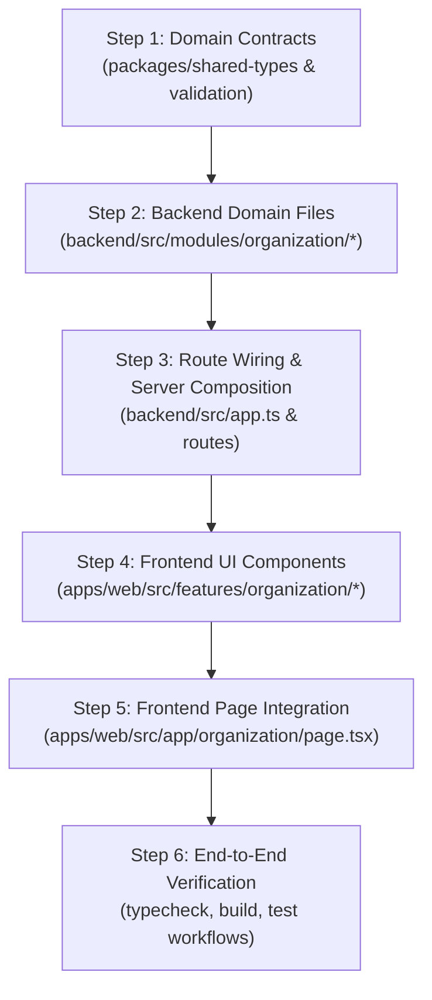

# Implementation Plan - Phase 01: Organization & Branch Management

Branch: `feature/organization-backend-frontend`  
Baseline Target: Universal School Platform (Zero hardcoded branding, multi-campus topology)

---

## 1. Objectives & Scope
Establish the foundational institution and multi-branch management domain:
- **Organization & School Profile:** Profile management (name, legal registration, contacts, address, branding assets).
- **Multi-Branch Topology:** Support for multiple campuses (Main branch, Secondary branches), branch codes (e.g. `MAIN`, `CITY`), shifts (Morning/Evening), and capacities.
- **Academic Years & Sessions:** Active academic year tracking (e.g., `2026-2027`), session boundaries, and terms.
- **Operational Settings:** Timezone, currency, and locale configurations.
- **Client Overlay Proof:** Seamlessly render default universal branding or client overlay ("My Best School") without modifying core service logic.

---

## 2. Architecture & File Breakdown

### A. Shared Contracts (`packages/shared-types` & `packages/validation`)
- Extend `packages/shared-types/src/index.ts` with:
  - `OrganizationProfile`, `Branch`, `Shift`, `AcademicYear`, `Term`, `OperationalSettings`.
- Add validation functions in `packages/validation/src/index.ts`:
  - `validateOrganizationUpdate()`, `validateBranchCreate()`, `validateAcademicYear()`.

### B. Dedicated Backend Domain (`backend/src/modules/organization/`)
Following the 6-file clean domain pattern:
1. `organization.types.ts`: Domain-specific internal contracts and filters.
2. `organization.schema.ts`: Request validation schemas.
3. `organization.repository.ts`: Repository interface and baseline in-memory store (zero database dependencies in Phase 1).
4. `organization.service.ts`: Business logic (ensures exactly 1 main branch, checks unique branch codes, validates active academic year transitions).
5. `organization.controller.ts`: Translates HTTP requests and maps responses to standard envelope `{ success: true, data: ... }`.
6. `organization.routes.ts`: Express router defining endpoints (`GET /profile`, `PUT /profile`, `GET /branches`, `POST /branches`, `GET /academic-years`, `POST /academic-years/activate`).

### C. Backend API Integration (`backend/src/`)
- Wire `organization.routes.ts` into `backend/src/app.ts` under `/api/v1/organization`.
- Add standard error handling and request composition.

### D. Frontend Feature Components (`apps/web/src/features/organization/`)
1. `components/SchoolProfileCard.tsx`: Displays institution registration, dynamic logo/avatar, and contact coordinates.
2. `components/BranchSelector.tsx`: Interactive campus switch dropdown/pills with active branch state.
3. `components/BranchListTable.tsx`: Full branch roster displaying code, status, shifts, and address.
4. `components/AcademicYearBadge.tsx`: Visual session indicator with active term pill.
5. Create page: `apps/web/src/app/organization/page.tsx` as an administrative management console.

---

## 3. Step-by-Step Implementation Steps

1. **Step 1:** Expand domain types in `packages/shared-types` & validators in `packages/validation`.
2. **Step 2:** Implement the 6 backend module files under `backend/src/modules/organization/`.
3. **Step 3:** Mount organization routes in `backend/src/app.ts` with standard responses.
4. **Step 4:** Build responsive UI components in `apps/web/src/features/organization/`.
5. **Step 5:** Create the dedicated `/organization` route in Next.js App Router.
6. **Step 6:** Run `npm run typecheck` and `npm run build` to verify clean builds without regressions.

---

## 4. Acceptance & Verification Checklist
- [ ] No hardcoded school or branch names in backend business logic.
- [ ] Multiple branches can be created and queried with distinct branch codes.
- [ ] Active academic year switch is guarded and validated.
- [ ] Next.js UI cleanly displays both universal baseline and "My Best School" client preset.
- [ ] `npm run typecheck` passes with zero errors.
- [ ] `npm run build` compiles successfully.
